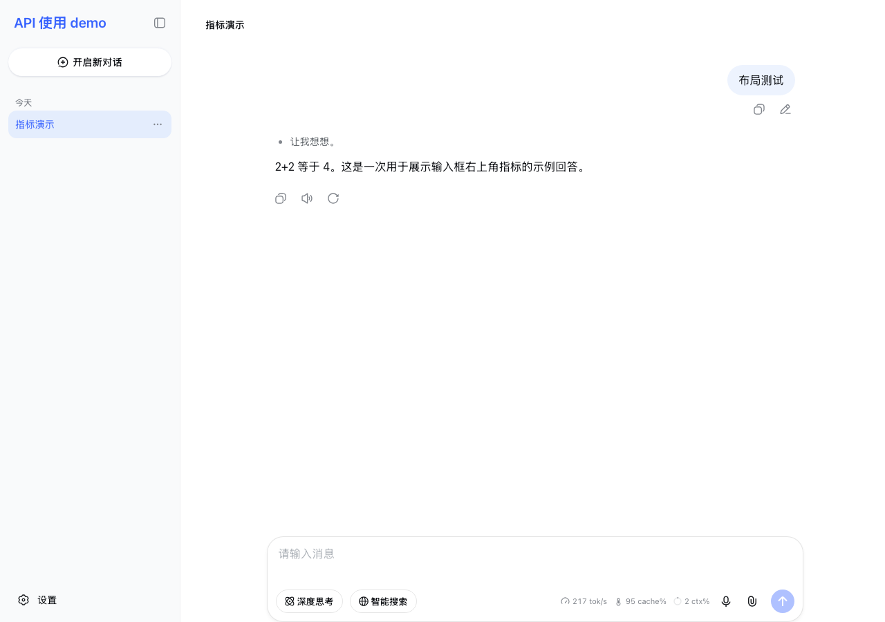

# dschat

跨端 DeepSeek 聊天客户端：一个本地 `chatsvr` 引擎 + 内嵌 Web UI，以及一个可选的 `sessionsvr` 同步中心。桌面端与 Android/iOS 共用同一份 Go 引擎。

当前进度：**官方 demo 前端已接到 chatsvr**，本地引擎 + sessionsvr 同步已跑通；macOS 菜单栏、Windows 托盘、Android WebView 壳均已构建。官方网关尚未完成。

协议和数据库结构已收敛为 **v1**：sessionsvr 的 `protocol=1`，chatsvr/sessionsvr 的 schema 均为 v1。不保留旧库迁移和旧协议兼容；升级时必须使用新数据目录或重新导入。



## 现在能做什么

- 本地 chatsvr：会话、turn 树、流式输出、thinking 块、联网搜索/读链接、服务端标题、附件、停止、重新生成、编辑问题、版本切换。
- Web UI（`go:embed` 进单二进制）：上述功能的界面，Enter 发送、SSE 流式渲染、Markdown。
- sessionsvr：密码登录、access/refresh token、会话/回合同步、会话级 owner、跨设备 claim、只读、SSE 通知。
- 会话删除：chatsvr 物理删除（含本地附件文件），sessionsvr 软删除并广播；其他设备立即删除，离线设备重连时对账删除；7 天后 sessionsvr 硬删并清理 blob。
- 删除所有本地对话：只删除本设备 owner 的会话，其他设备的只读会话保留；已同步的会话同时从 sessionsvr 删除。
- 侧栏会话状态：实心云=本设备拥有，空心云=其他设备拥有；时钟角标=仅本地/等待同步，旋转角标=正在传输，叉角标=存在本地碎片，琥珀色感叹号=同步被阻塞（任何上传/下载失败：网络、密码/会员、并发限制等）；未连接时不绘制。
- 注销设备只隐藏图标并断开同步，不丢会话；切换 sessionsvr 时旧服务器的已同步会话转为本地会话（时钟角标），不会被新服务器的列表对账删除；重连同一服务器保持原同步状态。
- 两台设备抢同一个会话：旧设备收到 `owner_changed` 后变只读，新设备接管并把遗留 open turn 用 `aborted` 闭合。

## 前端

- `/`：官方 chat-demo 前端（MIT，源码在 `app/core/web/app`），视觉与交互照抄官方。会话、消息、turn 树、设置全部来自 chatsvr；所有 DeepSeek 请求经 `/api/llm/*` 由 chatsvr 注入 key，浏览器不保存 key、也不直接访问任何外部 API。
- 注意：由于后端是 turn 模型（重新生成 = 同一父节点下新增一个带 Q 副本的 turn），官方 UI 的版本选择器会显示在「问题」一侧，而不是「回答」一侧；样式一致，位置与官方 demo 略有差异。

## 构建

```sh
make build            # 只编 Go；仓库里已带构建好的 dist
make web              # 改了前端后重新构建 dist（需要 pnpm）
make shells           # macOS .app + Windows .exe
make app-macos        # dist/Dschat.app（需要 Xcode）
make app-windows      # dist/dschat-windows-amd64.exe（需要 mingw-w64）
make android          # dist/android/dschat-debug.apk + chatsvr.aar
```

`make build` 产物：`bin/dschat`（macOS，默认带菜单栏）、`bin/sessionsvr`。
`make shells` 产物：`dist/Dschat.app`（arm64/x86_64 universal）、`dist/dschat-windows-amd64.exe`。
`make android` 产物：`dist/android/dschat-debug.apk`、`dist/android/chatsvr.aar`（需要 Android SDK + NDK 27.2 + gomobile）。

发布包：

```sh
./scripts/build-release.sh
```

产物在 `dist/release/`：

- `dschat-macos-arm64.zip`（未签名）
- `dschat-windows-amd64.zip`（未签名）
- `sessionsvr-darwin-arm64.tar.gz`
- `sessionsvr-linux-arm64.tar.gz`
- `sessionsvr-linux-amd64.tar.gz`
- `sessionsvr-windows-amd64.zip`
- `SHA256SUMS`

GitHub Actions 在 push main 时构建中间产物，push `v*` tag 时创建 GitHub Release。`sessionsvr` 包内带 `config.properties.example`，复制为同目录 `config.properties` 后启动。

## 运行

1. 启动 sessionsvr（可选）：

`sessionsvr` 要求**同目录**有 `config.properties`（可从 `sessionsvr/config.properties.example` 复制）：

```properties
PASSWORD=
```

```sh
./bin/sessionsvr -addr :5218 -data ~/.dschat/sessionsvr
```

- `PASSWORD` 为空时不校验密码，启动日志会打多行警告；只建议本机/可信局域网。
- 密码非空时，客户端连接需要输入该密码；密码只在连接时验证一次，之后走 access/refresh token。

2. 启动客户端：

```sh
./bin/dschat
```

默认固定监听 `127.0.0.1:5217`，显示菜单栏/托盘图标，并拉起默认浏览器。端口被占用时启动失败，不会自动改端口。`-no-open` 不打开浏览器，`-serve` 不启动托盘（纯后台，适合脚本/测试），`-port` / `-data` 可覆盖。

macOS 也可以直接打开 app：

```sh
open dist/Dschat.app
```

Windows 双击 `dist/dschat-windows-amd64.exe`。托盘菜单：打开 / 配置 / 退出。

Android：

```sh
adb install -r dist/android/dschat-debug.apk
adb shell am start -n com.dschat.android/.MainActivity
```

引擎在 App 进程内由前台 Service 持有，WebView 加载 `127.0.0.1` 的同一个 UI；附件、语音、设置都走同一套 chatsvr。

3. 首次使用：右上角「设置」→ 填 DeepSeek API Key。Key 只保存在本机，不会发往 sessionsvr。

4. 需要多端同步：设置 → sessionsvr 地址 + 密码 → 连接。连接后**新建**的会话会同步；已有的本地会话不会自动上传（这是设计里待定的行为）。

## 目录

```
app/core/          # 全平台共用（纯 Go）
  chatsvr/         # turn 引擎、本地 API、同步客户端、附件
  deepseek/        # Messages / Files 客户端
  model/ xdb/ apierr/ httpx/
  web/             # 内嵌前端：dist/（官方 demo 构建产物）+ app/（demo 源码）
app/desktop/       # macOS + Windows 共用：引擎启动 + 菜单栏/托盘 + 开浏览器
app/osx/           # darwin main
app/win/           # Windows 入口、托盘、exe 资源
app/mobile/        # gomobile 门面，Android + iOS 共用
app/android/       # Kotlin + Gradle + WebView + 前台 Service
app/ios/           # Swift + Xcode（规划）
sessionsvr/        # 同步服务，单二进制
docs/design.md     # 设计文档
```

边界约定：`app/core` 不出现平台专属 import；`app/desktop` 只服务 mac/win；`app/mobile` 只服务 android/ios；平台目录只放入口与打包资源。

## 数据

- 客户端：`~/.dschat/app/`（`chatsvr.db`、`attachments/`、`api-token`）
- 同步服务：`~/.dschat/sessionsvr/`（`sessionsvr.db`）

目录权限 0700，数据库/附件 0600。`-data` 可改。

## 已验证

- 用 mock DeepSeek SSE 跑通：thinking/text/signature/usage/title → 本地落库 → 推送 sessionsvr。
- 重新生成产生兄弟 turn；切版本会改变可见路径。
- 双设备 claim：旧设备 SSE 收到 owner 变更 → 只读；旧设备发问返回 `READ_ONLY`。
- 同一 chatsvr 双窗口：B 的列表通过 SSE 自动出现新会话；生成中打开时 chatsvr 返回内存中的部分输出，B 能看到已生成的前缀并继续接收后续 SSE。
- 两个 chatsvr 连同一 sessionsvr：B 的列表自动出现新会话，打开后显示等待点（只读）；A 完成后 B 自动刷新出完整回答。
- 同一 session 两个窗口并发发 turn：chatsvr 用 `sending`/`active` 原子占位，只有一个请求返回 200，另一个返回 409 `TURN_IN_PROGRESS`；不会产生两个 open turn。
- 附件端到端：A 上传图片 → sessionsvr 存 blob → B 同步下载 → claim → 用 B 的 key 重新上传 file_id → 继续追问成功。
- DeepSeek ZIP 导入：图片上传、合并、重复导入产生副本、自动上传 sessionsvr 已验证。
- 抢占者闭合遗留 open turn（`aborted`），本地与 sessionsvr 一致。
- 上下文组装会跳过 aborted turn，且只回传 text + read_link 工具块。
- UI E2E（Playwright + 本机 Edge）：发消息、流式渲染、设置弹窗，无 console error。
- `go test ./...` 覆盖可见路径、上下文链、sessionsvr 的 append/claim/open-turn 规则。

## 已知缺口

- API key 和 sessionsvr token 目前明文存在本地 SQLite（目录 0700），keychain 接入未做。
- 单实例锁、macOS 签名/公证、Windows 安装包/代码签名未做；未签名的 macOS app 首次打开需要右键「打开」，Windows 可能触发 SmartScreen。
- Android 目前只出 debug APK（全 ABI，约 141 MiB），没有 release 签名/上架；iOS 壳未做。
- 官方 UI 已把非 owner 的会话置为只读（输入框禁用、显示等待点），但还没有「接管」按钮；消息上的重新生成等操作仍可能发出 `READ_ONLY` 请求。
- 跨 chatsvr 的生成过程只同步「正在思考」状态，不逐 token 同步；回答在 turn 完成后才出现在另一台设备。
- 数据管理只提供 DeepSeek 官方 ZIP 导入，不提供导出；导入会合并，重复导入产生重复会话；非图片附件只有元数据。
- 会话删除已清理 chatsvr 本地附件文件；sessionsvr 附件随软删会话在 7 天后硬删。单附件/被替换附件的独立 GC 仍未做。
- DeepSeek `file_id` 不跨设备同步，每台设备用自己的 key 重新上传并缓存 6 天。
- 官方 UI 的版本选择器显示在问题一侧（turn 级映射），与官方回答侧的交互位置不同。
- 官方共享 key / 网关 / 计费未做。
- 不支持删除单条 turn / 单个版本，不支持「续写」（设计决定）。

## 设计

完整方案见 [docs/design.md](docs/design.md)。核心模型：session 是一棵 turn 树，turn = Q + A，虚拟根 `"0"`；同步只有 `appendTurn(Q)` 和 `appendAnswer(A)` 两个动作。
